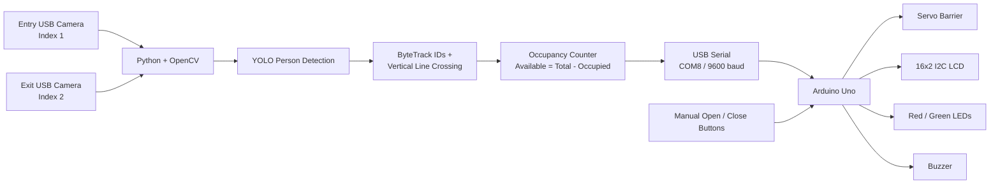

# Dual-Camera AI-Based Parking Slot Monitoring and Gate Control System

**Repository name:** Crowd-management-system-using-2-cam-and-py-as-brain  
**Category:** Embedded systems · Computer vision · AI-assisted automation

A prototype that uses two USB webcams and a Python/YOLO computer-vision pipeline to monitor person crossings at separate entry and exit views. An Arduino Uno receives serial commands and controls a servo barrier, LEDs, buzzer, and 16×2 I²C LCD.

> **Scope clarification:** The implementation estimates parking occupancy from person line-crossing events. It does not recognize vehicles or forecast general crowd density. One person crossing is treated as one parking occupancy event, which is a prototype assumption rather than a production-grade vehicle-counting method.

## Features

- Two simultaneous USB cameras: entry index 1 and exit index 2 (indices may vary by computer).
- YOLO person-only detection using COCO class 0.
- Independent ByteTrack tracking for each camera.
- Vertical line-crossing detection; both views use right-to-left crossing.
- Occupancy and available-slot calculation.
- USB serial communication with Arduino Uno (default COM8, 9600 baud).
- Servo gate, red/green status LEDs, buzzer, and I²C LCD.
- Manual open and close push buttons.
- Two-beep warning on an entry attempt when capacity is full.
- Keyboard R to reset and Esc to exit.

## System block diagram



## Architecture

1. The operator enters the total parking capacity.
2. OpenCV opens the entry and exit webcams.
3. YOLO detects people; ByteTrack maintains a tracking ID for each camera stream.
4. The system checks whether a tracked person's centroid crosses the vertical line from right to left.
5. Entry crossings increment occupancy; exit crossings decrement it.
6. Occupancy is clamped between zero and total capacity. Available slots equal total capacity minus occupancy.
7. Python sends slot and gate commands to the Uno. The Uno drives the physical outputs.

See [docs/architecture.md](docs/architecture.md) and [docs/algorithm.md](docs/algorithm.md).

## Repository structure

```text
.
├── README.md
├── requirements.txt
├── .gitignore
├── src/
│   ├── arduino/parking_gate_controller.ino
│   └── python/dual_camera_parking.py
├── hardware/
│   ├── components.md
│   └── wiring.md
├── docs/
│   ├── architecture.md
│   ├── algorithm.md
│   ├── design-decisions.md
│   ├── software-setup.md
│   ├── testing.md
│   └── contributions-and-ai-disclosure.md
└── media/README.md
```

## Hardware

| Component | Purpose |
|---|---|
| Arduino Uno | Embedded control and serial command receiver |
| 2 × USB webcams | Separate entry and exit views |
| SG90 servo | Demonstration gate barrier |
| 16×2 I²C LCD | Available-slot display |
| Active buzzer | Full-capacity warning |
| Red and green LEDs | Gate status |
| 2 push buttons | Manual open and close |
| Jumper wires, resistors, USB cable | Interconnections |

See [hardware/wiring.md](hardware/wiring.md) for pin assignments and power notes.

## Software requirements

- Python 3.10 or a compatible version supported by the installed PyTorch/Ultralytics release.
- Arduino IDE 2.x and Arduino AVR Boards package.
- Python dependencies in [requirements.txt](requirements.txt).
- Arduino libraries: LiquidCrystal_I2C. Wire and Servo are standard Arduino libraries.

Setup instructions: [docs/software-setup.md](docs/software-setup.md).

## Run

1. Upload src/arduino/parking_gate_controller.ino to the Uno.
2. Connect both USB cameras and verify their OpenCV indices.
3. Install Python dependencies.
4. Update SERIAL_PORT in the Python file if the Uno is not on COM8.
5. Run: python src/python/dual_camera_parking.py
6. Enter a positive total-slot value.
7. Press R to reset the estimated count or Esc to exit.

The first YOLO run may download yolov8n.pt automatically. Close Arduino Serial Monitor before starting Python.

## Serial protocol

| Command | Meaning |
|---|---|
| S<number> | Set available slot count |
| O | Open gate, only if capacity is available |
| C | Close gate |
| E | Play two warning beeps |

Commands are newline-terminated at 9600 baud.

## Limitations and responsible use

- The prototype counts people, not vehicles. Pedestrians, passengers, staff, and multiple people in one vehicle can distort the occupancy estimate.
- Correct counting depends on camera placement and the expected right-to-left crossing direction.
- Tracking can fail under heavy occlusion, overlap, low light, or abrupt movement.
- Camera indices and COM port are machine-specific.
- Occupancy is not persisted; it resets when the Python program restarts.
- This is an academic prototype, not a certified access-control or life-safety system. Do not use it as the sole control for a real parking facility.

## Testing

No accuracy, latency, or long-duration reliability figures are claimed. Record actual observations using [docs/testing.md](docs/testing.md) before publishing performance claims.

## Contributions and AI disclosure

The student project owner led the project concept, physical assembly, component selection, camera setup, hardware integration, testing, and definition of expected behavior. AI assistance was used for code drafting and iteration, troubleshooting guidance, and documentation preparation. The detailed division is in [docs/contributions-and-ai-disclosure.md](docs/contributions-and-ai-disclosure.md). Review and validate every source file before demonstration or deployment.


**Repository owner:** [@sdivyadarshan](https://github.com/sdivyadarshan)


